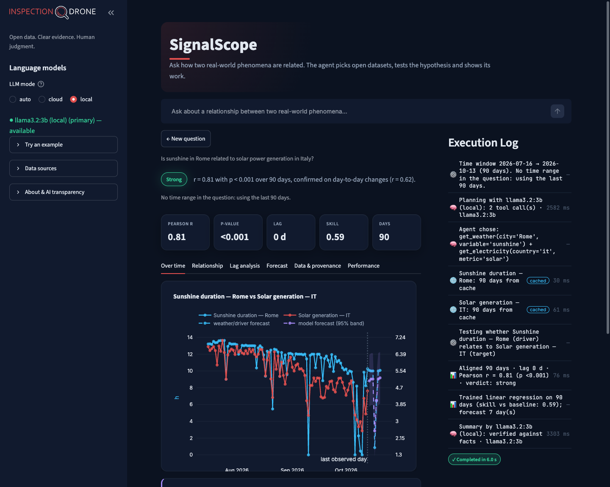
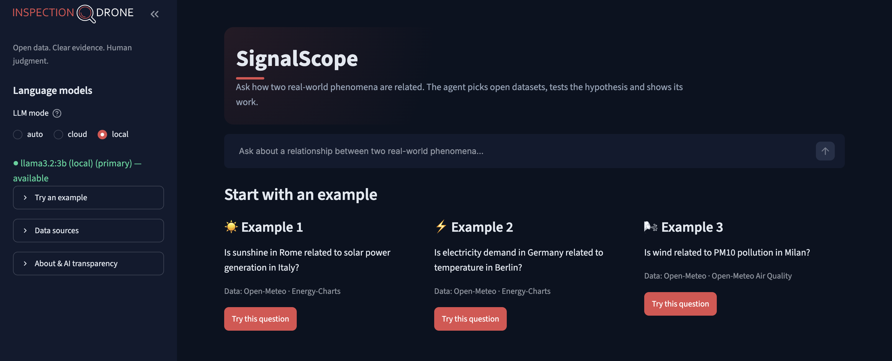
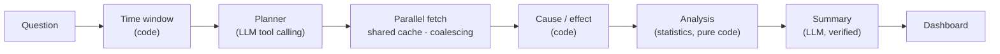

# SignalScope

**Ask in plain language whether two real-world phenomena are related. An AI agent picks the right open datasets, tests the hypothesis with statistics that do not fool themselves, forecasts where it can, and shows every step it took.**

*Prepared for the InspectionDrone technical assessment.*



<details><summary>Start screen</summary>



</details>

> **"Is sunshine in Rome related to solar power generation in Italy?"**
> The agent fetches 90 days of daily sunshine for Rome (Open-Meteo) and Italy's solar generation (Energy-Charts), aligns them, and reports **strong evidence**: Pearson r = 0.81, p < 0.001, confirmed on day-to-day changes (r = 0.62). A regression beats a naive baseline by 59 % on held-out days, a 7-day forecast is driven by the real weather forecast, and the written summary is checked against the computed numbers. Answered in about 6 seconds.

---

## Contents

1. [What it does](#1-what-it-does)
2. [Installation and running](#2-installation-and-running)
3. [Using the dashboard](#3-using-the-dashboard)
4. [What makes it different](#4-what-makes-it-different)
5. [Architecture](#5-architecture)
6. [Efficiency and scalability](#6-efficiency-and-scalability)
7. [Limitations and improvements](#7-limitations-and-improvements)
8. [Compliance](#8-compliance)
9. [Project structure](#9-project-structure)

📘 **The full [design document](docs/DESIGN.md)** covers the architecture, data processing, AI agent, statistical method, efficiency, scalability under load, AI API costs, limitations and GDPR / EU AI Act in detail, with measurements.

---

## 1. What it does

| Requirement | How SignalScope meets it |
|---|---|
| At least two public APIs | 5 tools over 4 independent providers, all free and keyless: **Open-Meteo** (weather, air quality), **Wikimedia Pageviews** (public interest in a topic), **Frankfurter / ECB** (exchange rates), **Energy-Charts / Fraunhofer ISE** (electricity load, solar and wind generation) |
| AI agent that decides which APIs to call | An LLM with tool calling chooses two datasets for the question; its choices are validated, checked against the question and repaired if needed |
| Fetch and structure the data | Calendar-correct daily alignment, no invented values, provenance (source, licence, exact request URL) for every series |
| Lightweight ML / statistics | Lag-aware Pearson and Spearman correlation with autocorrelation-adjusted p-values, a spurious-trend check, linear regression evaluated on held-out days against a baseline, 7-day forecast with intervals |
| Dashboard | Chat input, live **Execution Log**, interactive charts (time series, relationship, lag analysis, forecast, performance timeline), and an AI-written summary verified against the numbers |

Example questions it handles well:
- "Is sunshine in Rome related to solar power generation in Italy?"
- "Is electricity demand in Germany related to temperature in Berlin?"
- "Is wind related to PM10 pollution in Milan?"
- "Is temperature in Milan related to interest in ice cream?"
- "Is the euro–dollar exchange rate related to interest in Bitcoin?" (correctly answers: no evidence)

---

## 2. Installation and running

You need about 10 minutes and 3 GB of free disk space (most of it for the local language model).

### 2.1 Prerequisites

| Tool | Why | Install |
|---|---|---|
| **Python 3.10 or newer** | runs the app | [python.org/downloads](https://www.python.org/downloads/) · macOS: `brew install python@3.12` · check with `python3 --version` |
| **Git** | download the code | [git-scm.com/downloads](https://git-scm.com/downloads) · check with `git --version` |
| **Ollama** | runs the local language model (fallback, and the only model if you have no OpenRouter key) | see 2.2 |
| OpenRouter account *(optional)* | free cloud model, more accurate than the local one | see 2.3 |
| Docker *(optional)* | run everything in a container | see 2.5 |

### 2.2 Install Ollama and download the local model

1. Install Ollama:
   - **macOS**: download the app from [ollama.com/download](https://ollama.com/download) and open it, or run `brew install ollama` and then `ollama serve` in a terminal.
   - **Linux**: `curl -fsSL https://ollama.com/install.sh | sh`
   - **Windows**: download and run the installer from [ollama.com/download](https://ollama.com/download).
2. Download the model used by SignalScope (about 2 GB):
   ```bash
   ollama pull llama3.2:3b
   ```
3. Check that it is available:
   ```bash
   ollama list                               # should list llama3.2:3b
   curl http://localhost:11434/v1/models     # should return JSON with "llama3.2:3b"
   ```

Ollama keeps running in the background and serves the model on `http://localhost:11434`.

### 2.3 Optional: free OpenRouter key (cloud model)

1. Create a free account at [openrouter.ai](https://openrouter.ai) and create a key under **Keys**.
2. Put the key in the `.env` file (step 2.4). The key stays on your machine and is never committed (`.env` is git-ignored).

**Daily limit of the free tier.** OpenRouter allows **50 free-model requests per day per account**. A new question uses 2 requests (one to plan, one to summarise), so this is **about 25 new questions per day**. Repeated questions are served from cache and use none. The counter resets at 00:00 UTC; buying $10 of credits raises the limit to 1,000 requests per day. When the limit is reached, or when no key is set, SignalScope **automatically switches to the local model** and says so in the execution log and in the sidebar ("daily free limit reached"). Data, statistics and charts work exactly the same.

### 2.4 Run locally

```bash
git clone https://github.com/rezar771/signalscope.git
cd signalscope

python3 -m venv .venv
.venv/bin/pip install -r requirements.txt        # Windows: .venv\Scripts\pip install -r requirements.txt

cp .env.example .env                              # then optionally add OPENROUTER_API_KEY
.venv/bin/streamlit run app.py                    # Windows: .venv\Scripts\streamlit run app.py
```

Open **http://localhost:8501**.

Configuration (`.env`, all optional):

| Variable | Default | Meaning |
|---|---|---|
| `LLM_MODE` | `auto` | `auto` = cloud model first, local on failure · `cloud` = cloud only · `local` = local only, nothing is sent to an AI provider |
| `OPENROUTER_API_KEY` | empty | free key from openrouter.ai |
| `OPENROUTER_MODEL` | `nvidia/nemotron-3-super-120b-a12b:free` | any OpenRouter model with tool calling |
| `OLLAMA_URL` | `http://localhost:11434/v1` | Ollama's OpenAI-compatible endpoint |
| `OLLAMA_MODEL` | `llama3.2:3b` | any Ollama model with tool calling |
| `HTTP_TIMEOUT_S`, `LLM_TIMEOUT_S`, `CACHE_TTL_S` | 45, 60, 3600 | timeouts and cache lifetime in seconds |

The mode can also be switched per session in the sidebar.

### 2.5 Run with Docker

1. Install **Docker Desktop** ([docker.com/products/docker-desktop](https://www.docker.com/products/docker-desktop/)) on macOS or Windows, or **Docker Engine** on Linux ([docs.docker.com/engine/install](https://docs.docker.com/engine/install/)). Start it and check with `docker --version`.
2. Keep Ollama running on the host (step 2.2). On **Linux**, start it so that containers can reach it: `OLLAMA_HOST=0.0.0.0 ollama serve`.
3. Build and run:
   ```bash
   docker build -t signalscope .
   docker run -p 8501:8501 --env-file .env --add-host=host.docker.internal:host-gateway signalscope
   ```
4. Open **http://localhost:8501**.

The image (about 1.1 GB) runs as a non-root user and has a health check on `/_stcore/health`. Inside the container the app reaches Ollama at `http://host.docker.internal:11434/v1`.

### 2.6 Troubleshooting

| Symptom | Fix |
|---|---|
| Sidebar: `llama3.2:3b … unreachable` | start Ollama (`ollama serve` or open the Ollama app) |
| Sidebar: `model not pulled` | `ollama pull llama3.2:3b` |
| Sidebar: `daily free limit reached` | wait for the 00:00 UTC reset, use another key, or select `local` |
| Docker: the app cannot reach Ollama | add `--add-host=host.docker.internal:host-gateway`; on Linux run Ollama with `OLLAMA_HOST=0.0.0.0` |
| First question is slow | the local model is loaded into memory on first use (a few seconds); data APIs are slower on the first request and cached afterwards |

### 2.7 Tests and load test

```bash
.venv/bin/python -m pytest                                        # 177 tests, offline, ~8 s
.venv/bin/python scripts/load_test.py --users 10 --mode same --llm local
```

---

## 3. Using the dashboard

- **Ask** a question in the box under the title, or click an example.
- **Execution Log** (right) fills live: each step with its duration, whether the data came from the network or the cache, and which model answered.
- **Verdict and key numbers**: Strong / Moderate / Weak / None / Insufficient, with the reason, Pearson r, p-value, lag, model skill and number of days. Hover a card for an explanation.
- **Tabs**: *Over time* (both series and the forecast), *Relationship* (scatter with fit and confidence band, coloured by date), *Lag analysis*, *Forecast*, *Data & provenance* (sources, licences, request URLs, CSV download), *Performance* (timings, tokens, cache hits, timeline).
- **Summary**: labelled "AI-generated" when written by the model and verified, or "Computed summary" when the model's text failed verification and a deterministic summary is shown instead. Caveats are always listed.
- **← New question** returns to the start screen; earlier questions stay available below.

---

## 4. What makes it different

Most solutions follow the same pipeline: LLM → two API calls → one Pearson r → a chart → an LLM paragraph. SignalScope keeps that pipeline but makes it **trustworthy, efficient and scalable**, and every point below came from measuring something and fixing what the measurement showed:

- **Statistics that resist false correlations.** P-values are corrected for autocorrelation, day-to-day changes are checked for shared trends, and lag scanning is corrected for multiple testing. On 300 pairs of *unrelated* random walks, a naive Pearson test reports significance **75.7 %** of the time; SignalScope reports strong or moderate evidence **0 %** of the time.
- **The LLM decides *what*, code decides *how*.** The model chooses the datasets and phrases the result; dates, name resolution, validation, cause/effect and every number are computed by code. Summaries are verified against the numbers (no invented figures, correct direction, no causal claims) and replaced by a deterministic summary if they fail.
- **Guarded tool calling.** Arguments are validated and normalised, values copied from prompt examples are rejected, unsupported currencies are caught before fetching, and the model gets one repair round with precise errors.
- **From 68 s to about 6 s per question.** Disabling the cloud model's hidden reasoning cut planning to 1–2 s with 11/11 correct plans; only compact facts are sent to the LLM (~1,250 tokens per question).
- **Ten users cost what one costs.** Request coalescing, shared caches and per-model concurrency limits: ten simultaneous users asking the same new question needed **2 LLM calls in total**.
- **Automatic fallback** from the free cloud model to the local model on rate limits, errors or invalid output, with the remaining quota visible in the sidebar.
- **Full transparency.** A live execution log, a performance timeline and data provenance (source, licence, exact request URL) for every series.

Details and measurements: [design document, section 1](docs/DESIGN.md#1-what-makes-it-different).

---

## 5. Architecture



Five layers with one-way dependencies: **UI → agent → analysis → data sources → core**. Layers exchange only typed objects (time series, plan, analysis facts, run result), and the UI only renders results. Each layer is tested on its own.

| Decision | Why |
|---|---|
| Custom tool calling instead of LangChain | two bounded LLM calls; tool schemas and argument validation come from the same pydantic models; easy to test and explain |
| One OpenAI-compatible client for all models | OpenRouter and Ollama today; any other provider is a configuration entry |
| Fallback on failure instead of routing by difficulty | routing would need an extra LLM call; escalating on a rate limit or failed validation is simpler and generalises to cost-based cascading |
| Only computed facts go to the LLM | constant, small prompts; no raw or personal data in prompts; every number comes from code |
| One execution trace for everything | drives the live log, the performance view, token counts and the load test; maps to OpenTelemetry in production |

Full architecture, data contracts and request flow: [design document, section 2](docs/DESIGN.md#2-architecture).

---

## 6. Efficiency and scalability

**One user**: about **6 s** for a new question (planning 1–2 s, data 0.1–2.4 s in parallel, analysis ~50 ms, summary ~1.5–3 s); under 1 s when the question was asked before.

**Ten simultaneous users** (load test, live APIs, local model):

| Scenario | Answered | Median | LLM calls (naive: 20) |
|---|---|---|---|
| 10 different questions, first time | 10 / 10 | 20.4 s | 11 |
| 10 different questions, repeated | 10 / 10 | 0.5 s | 2 |
| **10 users, the same new question** | 10 / 10 | **7.2 s** | **2** |

**How it scales today**: per-task HTTP sessions over a shared cache, single-flight coalescing of identical data requests and LLM calls, plan and summary caches, per-model concurrency limits with fast fallback, bounded inputs.

**For heavy traffic** (production design):

```
Load balancer (sticky) → UI replicas → stateless FastAPI → queue → autoscaled workers
   Redis: HTTP cache · coalescing locks · plan/summary cache · rate limits
   LLM gateway: paid API with SLA or vLLM GPU pool · per-tenant quotas
   pre-fetching of popular series · circuit breakers · OpenTelemetry
```

The measured bottlenecks are the LLM and the slowest data provider, not the web tier, so the first investments are the LLM gateway, pre-fetching and queueing. LLM cost is about **$0.19–0.71 per 1,000 questions** with paid models at current prices.

Latency per phase, the full load test, the production architecture and costs: [design document, sections 6–8](docs/DESIGN.md#6-efficiency).

---

## 7. Limitations and improvements

- **Correlation is not causation.** The app says so on every result; a causal-analysis module (Granger tests, control variables) would be the next step.
- **Two series, linear model, daily data, 14–90 days.** Improvements: multiple drivers, non-linear models, seasonal adjustment, intraday sources, longer history.
- **LLM capacity and the free tier** (~25 questions per day). Improvements: a paid tier or a self-hosted GPU model, streaming summaries.
- **The local model plans less reliably** (5 of 7 in tests). Improvements: a larger local model, a fixed evaluation set run on every change, letting the user confirm the plan.
- **Slow or failing data providers.** Improvements: pre-fetching, circuit breakers, more providers.
- **Single process, in-memory caches.** Improvement: the production architecture above.

The complete table, with impact and current mitigation for each item: [design document, section 9](docs/DESIGN.md#9-limitations-and-improvements).

---

## 8. Compliance

- **GDPR**: source data is public and aggregated; the only potentially personal data is the question text, which stays in the browser session and short-lived memory caches; minimal data goes to the LLM; no cookies or tracking; `LLM_MODE=local` keeps questions on the machine. A production cloud setup needs a data processing agreement and EU-compliant transfers.
- **EU AI Act**: a limited-risk system with transparency obligations. AI-generated plans and summaries are labelled with the model that produced them, every number comes from documented statistics, and every step is logged.

Details: [design document, section 10](docs/DESIGN.md#10-gdpr-and-the-eu-ai-act).

---

## 9. Project structure

```
app.py                        Streamlit dashboard (rendering only)
signalscope/
  config.py                   settings from environment / .env
  trace.py                    timed execution events
  http.py                     shared cached HTTP session
  sources/                    geocoding, weather + air quality, wikipedia, fx, electricity
    registry.py               tool schemas + argument validation
  analysis/                   align, stats, model, report (pure functions)
  agent/
    llm.py                    OpenAI-compatible client, fallback cascade, quota-aware status
    planner.py                tool selection, validation, grounding, repair
    summarizer.py             grounded summary + verification
    orchestrator.py           one question → one result
    window.py cache.py singleflight.py prompts.py
  ui/                         charts (Plotly) and theme
tests/                        offline tests + recorded API fixtures
scripts/load_test.py          concurrent-users benchmark
docs/DESIGN.md                design document
Dockerfile · requirements.txt · .env.example
```
