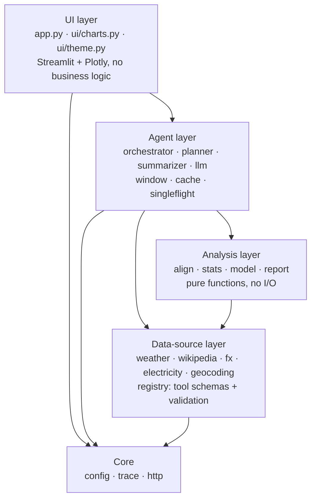
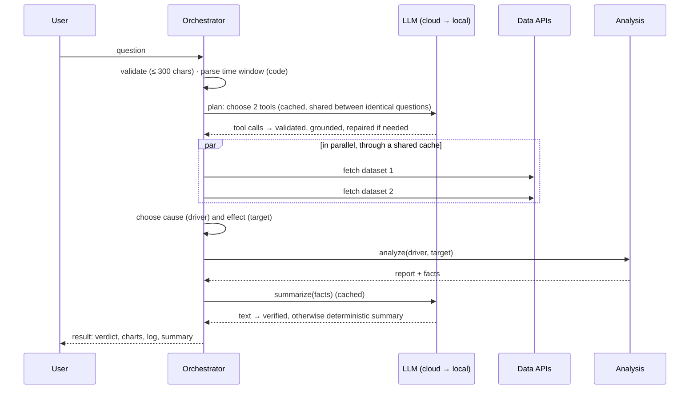
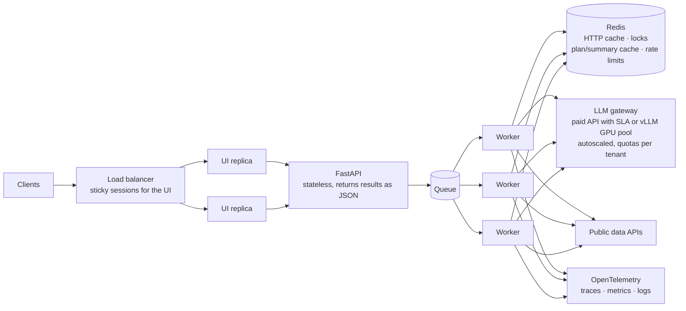

# SignalScope — Design document

This document explains how SignalScope is built and why: the information architecture, data processing, the AI agent, the statistical method, efficiency, scalability under load, AI API costs, limitations and possible improvements, and GDPR / EU AI Act considerations. Installation and usage are in the [README](../README.md).

All measurements were taken on 2026-10-14 on a MacBook (Apple Silicon, 16 GB RAM) against the live public APIs. Prices are OpenRouter list prices from the same day and are estimates.

## Contents

1. [What makes it different](#1-what-makes-it-different)
2. [Architecture](#2-architecture)
3. [Data sources and processing](#3-data-sources-and-processing)
4. [The AI agent and tool calling](#4-the-ai-agent-and-tool-calling)
5. [Statistical method](#5-statistical-method)
6. [Efficiency](#6-efficiency)
7. [Scalability](#7-scalability)
8. [AI API costs](#8-ai-api-costs)
9. [Limitations and improvements](#9-limitations-and-improvements)
10. [GDPR and the EU AI Act](#10-gdpr-and-the-eu-ai-act)
11. [Testing](#11-testing)

---

## 1. What makes it different

Most solutions to this task follow the same pipeline: LLM → two API calls → one Pearson r → a chart → an LLM paragraph. SignalScope uses that pipeline too, but makes it **trustworthy, observable, efficient and scalable**. Each point below came from measuring something and fixing what the measurement showed.

**Honest statistics**
- **Correction for autocorrelation.** Consecutive days are not independent, so naive p-values are far too optimistic. SignalScope computes an effective sample size and uses it for p-values and confidence intervals. On 300 pairs of *unrelated* random walks (like two prices drifting), a naive Pearson test reports a significant correlation **75.7 %** of the time; SignalScope reports strong or moderate evidence **0 %** of the time.
- **Spurious-trend check.** It also correlates the day-to-day *changes*. Two series that merely trend together are downgraded and flagged.
- **Lags without cheating.** It scans lags (effects are often delayed) and corrects the p-value for the number of lags tested. Weather can only *lead* the other series, never follow it (an early version reported "ice-cream interest leads Milan temperature by 7 days").
- **A model that must beat a baseline.** It is evaluated on later, unseen days against a naive average, and the lag is chosen without looking at those days. The forecast only uses past values and real weather forecasts.

**Trustworthy AI**
- **The LLM decides *what*, code decides *how*.** The model picks datasets and phrases results; dates, name resolution, validation, the choice of cause and effect, and every number are code. This split came from testing: the small local model turned "the last 60 days" into 30 days when it had to compute dates itself.
- **Verified summaries.** Every number in the AI summary must appear in the computed facts; the verdict, the direction of the relationship and the absence of causal claims ("causes", "affects") are checked. If anything fails, a deterministic summary is shown and labelled as such.
- **Guarded tool calls.** Arguments are validated and normalised, values copied from the prompt's examples are rejected (one model fetched "Umbrella" for a solar-power question), unsupported currencies are caught before fetching (a model asked for EUR/BTC), and the model gets exactly one repair round with precise error messages.

**Efficiency**
- **Hidden reasoning turned off.** The cloud model is a reasoning model and spent up to 68 s "thinking" for one question. Disabling it cut planning to 1–2 s and summaries to about 1.5 s, with **11 of 11** plans still correct.
- **Only facts go to the LLM**, never raw data: about 1,250 tokens per question, constant regardless of the time range.
- **A shared HTTP cache** (Energy-Charts takes up to 16 s per request; cached: about 20 ms), parallel fetching, and caches for plans and summaries: a repeated question needs **zero** LLM calls.

**Scalability**
- **Ten users asking the same new question cost what one user costs**: 2 LLM calls and 2 data fetches in total (measured), thanks to request coalescing.
- **Admission control per model.** Each model backend has a concurrency limit; a busy cloud model falls back to the local one within 2 s instead of queueing.
- **Automatic model fallback** on rate limits, errors or invalid output; the sidebar shows the remaining free quota.

**Observability**
- One **execution trace** drives the live log, the performance tab, the token counts and the load test, and maps one-to-one to OpenTelemetry spans in production.

---

## 2. Architecture

### 2.1 Layers



Dependencies only point downwards, and each layer is testable on its own: the analysis layer is pure functions over pandas objects, the data sources receive their HTTP session from outside (tests use recorded real responses), and the agent receives its LLM from outside (tests use scripted fakes). Replacing Streamlit with a React front end and a FastAPI back end would not touch any layer below the UI.

### 2.2 Data contracts

Four typed objects carry all information between layers:

| Contract | Produced by | Used by | Content |
|---|---|---|---|
| `TimeSeries` | data sources | analysis, UI | daily `history` (clean, sorted, no gaps filled), optional `future` (forecast days), label, unit, source, exact request URL, licence |
| `Plan` | planner | orchestrator, UI | the two validated tool calls, the model that produced them, number of LLM calls |
| `AnalysisReport` + `facts()` | analysis | summarizer, UI | correlations, lag scan, model, verdict, caveats; `facts()` is a small, rounded, JSON-safe dictionary with the same keys in every case |
| `RunResult` + trace | orchestrator | UI, load test | everything above plus timed events (LLM / API / analysis / system) with tokens, cache hits and errors |

`facts()` is the only thing the LLM ever sees about the data.

### 2.3 Request flow



The orchestrator never raises: any failure becomes a readable error message plus an entry in the execution log.

---

## 3. Data sources and processing

### 3.1 Sources

| Tool | Provider | Raw granularity → daily | Licence | Notes |
|---|---|---|---|---|
| `get_weather` | Open-Meteo historical + forecast APIs | daily | CC BY 4.0 | temperature, precipitation, wind, sunshine; history for the exact window **plus 7 forecast days** |
| `get_air_quality` | Open-Meteo air-quality API | hourly → daily mean (≥ 18 valid hours) | CC BY 4.0 | PM2.5, PM10, NO₂, ozone; 5 forecast days |
| `get_wikipedia_interest` | Wikimedia Pageviews + search | daily | CC0 | the topic is first resolved to the exact article title |
| `get_exchange_rate` | Frankfurter (ECB reference rates) | business days | ECB reuse policy | 30 currencies; weekends are **not** filled |
| `get_electricity` | Energy-Charts (Fraunhofer ISE) | 15 min → daily mean in GW (≥ 80 % coverage) | CC BY 4.0 | load, solar, wind for 9 European countries; daylight-saving days handled |

### 3.2 Processing pipeline

1. **Resolution**: city → coordinates and timezone; topic → canonical Wikipedia title; currency and country names → codes.
2. **Fetching** through one shared HTTP cache, with retries and backoff on rate limits and server errors, `Retry-After` respected, stale data served if a provider is down, and no cookies.
3. **Normalisation**: one clean daily series per source (local calendar day, sorted, de-duplicated). Sub-daily data is averaged only when a day is sufficiently covered.
4. **Window**: 14–90 complete days ending yesterday, parsed from the question ("last 3 weeks") by code; the default is 90 days.
5. **Alignment** by calendar date. Gaps stay gaps (no interpolation) and produce a caveat.
6. **Lagging by calendar**: the driver's dates are shifted and then joined, so Monday's exchange rate is correctly paired with Sunday's weather even though the exchange rate has no Sunday.

Problems found by testing against the live APIs, all invisible to offline tests:

| Finding | Fix |
|---|---|
| Open-Meteo's forecast endpoint returns empty values for the oldest ~15 days of a 92-day lookback (75 of 90 days) | history from the historical endpoint for the exact window, forecast separately → 90 of 90 days |
| Wikipedia sends `Vary: Cookie` with a cookie, so every repeated request missed the cache | cookies blocked on all data requests → cache hits (and nothing user-identifying stored) |
| Energy-Charts took 16.2 s for one cold request | 45 s read timeout without retrying slow reads (bounded worst case) |
| Parallel threads initialising the cache database at the same moment failed with `database is locked` | one cache backend per process; 20 simultaneous live fetches: 20/20 OK in 1.45 s |

---

## 4. The AI agent and tool calling

### 4.1 Two bounded LLM calls

| Call | The LLM receives | It returns | Guardrails |
|---|---|---|---|
| **Planning** | rules + two examples, the question (marked as data, not instructions), 5 tool schemas | two tool calls | schema validation and normalisation (synonyms, ECB currency list, country names); grounding check (no copied example values; a Wikipedia topic must relate to the question); one repair round with exact errors; escalation to the next model |
| **Summary** | rules, the question, `facts()` | 3–5 sentences | numbers must come from the facts; verdict word required; direction must match the sign of r; causal wording rejected; otherwise a deterministic summary |

A new question costs 2 LLM calls; a repeated one costs 0; the worst case is bounded (one repair and one fallback).

### 4.2 Tool calling without a framework

Each tool is defined once as a pydantic model. The registry turns these models into OpenAI-compatible function schemas **and** uses the same models to validate the LLM's arguments, so schema and validation cannot drift apart. LangChain or LlamaIndex would add a large dependency and hide control flow for what is two bounded calls; the custom loop is easier to test (scripted fake models), to bound and to explain.

Both backends speak the OpenAI chat-completions format, so one small client covers OpenRouter and Ollama, and adding another provider (OpenAI, Anthropic, Mistral, a self-hosted vLLM server) is a configuration entry.

### 4.3 Model strategy: fallback on failure, not routing by difficulty

```
OpenRouter  nvidia/nemotron-3-super-120b-a12b:free   (primary)
   │  rate limit (429) · server error · timeout · overloaded · invalid plan after repair
   ▼
Ollama      llama3.2:3b on this machine              (fallback; LLM_MODE=local uses only this)
```

No paid hosted LLM API was available for this assessment, so a free cloud model is the primary and a local model guarantees availability and privacy. Routing questions by "difficulty" was considered and rejected: it would need an extra LLM call to judge difficulty, adding latency and a new failure mode, for only two small calls. Escalating on an objective failure signal (a rate limit or a failed validation) is simpler, and the same pattern scales to cost-based cascading in production: cheap model first, stronger model only when needed.

Measured planning accuracy (same tools and prompts):

| Model | Correct plans | Planning time |
|---|---|---|
| nemotron-3-super, reasoning disabled | **11 / 11** | 1.0–2.1 s |
| nemotron-3-super, default reasoning | 7 / 7 | 2.4–11.5 s (one full question took 68 s) |
| llama3.2:3b, local | 5 / 7 | 1.0–3.9 s |
| nemotron-3.5-lightning (free) | 0 / 3 | about 2 s (called only one tool) |

---

## 5. Statistical method

| Step | Method | Why |
|---|---|---|
| Lag scan | Pearson r for lags −7 … +7 days (0 … +7 for weather and air-quality drivers) | real effects are often delayed |
| Lag choice | lag 0 unless another lag is clearly better (\|r\| higher by more than 0.05) | avoids chasing noise |
| Multiple testing | Bonferroni correction over the lags tested | testing 8–15 lags inflates false positives |
| Autocorrelation | effective sample size `n_eff = n(1 − ρx·ρy)/(1 + ρx·ρy)` from lag-1 autocorrelations; p-values and 95 % confidence intervals use `n_eff` | consecutive days are not independent |
| Spurious trend | correlation of day-to-day changes, never across gaps | shared trends create false correlations |
| Robustness | Spearman ρ next to Pearson r | outliers |
| Verdict | strong / moderate / weak / none / insufficient from explicit rules on \|r\|, p, sample size and the trend check | a clear, explainable label |
| Model | linear regression on the lagged driver, plus day-of-week effects from 28 days of data | simple, fast, explainable |
| Evaluation | last 20 % of days held out (at least 7), lag chosen on training days only, error compared with a naive (weekday) average → skill score | no leakage; shows whether the model is better than "just the average" |
| Forecast | up to 7 days, only from past driver values and real weather forecasts, 95 % interval | never uses future information |

Measured on 300 synthetic datasets with **no** real relationship (90 days each):

| Data | Naive Pearson p < 0.05 | SignalScope "strong" or "moderate" |
|---|---|---|
| independent noise | 5.7 % | 4.7 % (the expected ~5 %, even after scanning lags) |
| independent random walks | **75.7 %** | **0.0 %** |
| independent noise around a shared trend (200 sets) | — | 0.0 % |

These properties are part of the automated tests. The analysis takes 36–68 ms per question.

---

## 6. Efficiency

Measured end to end for one user:

| Phase | First time | Repeated |
|---|---|---|
| Planning (LLM) | 1.0–2.1 s cloud · 1.0–3.9 s local | 0 s (plan cache) |
| Data, 2 APIs in parallel | 0.1–2.4 s typical; Energy-Charts up to 16 s | 3–60 ms (HTTP cache) |
| Analysis | 36–68 ms | same |
| Summary (LLM) | 1.3–1.7 s cloud · 2–3 s local | 0 s (summary cache) |
| **Whole question** | **about 6 s** (measured 5.6–6.0 s on the local model) | under 1 s when everything is cached |

What keeps it efficient:
- **Two LLM calls per question with small, constant prompts** (about 1,250 tokens in, 200 out), because only computed facts are sent.
- **Hidden reasoning disabled** on the cloud model (the largest single latency win).
- **Parallel data fetching** and a **shared on-disk HTTP cache** (1 h lifetime) used by every user.
- **Plan and summary caches**: identical questions skip the LLM entirely.
- **Request coalescing**: identical requests in flight at the same moment share one execution.
- **Cheap deterministic work**: dates, validation and all statistics run in milliseconds.

---

## 7. Scalability

### 7.1 What the current version does

Target: about 10 simultaneous users on a single process, with no wrong results, no duplicated work and no silent hangs. The work is I/O-bound (HTTP and LLM), so threads are sufficient.

| Concern | Mechanism |
|---|---|
| Thread safety | one HTTP session per fetch task; one shared cache backend per process (WAL mode, busy timeout) |
| Cache stampede (many users, same data) | **single-flight**: identical requests already in progress are shared |
| Identical new questions at the same moment | single-flight for planning and summaries as well, with a double-checked cache (two timing bugs here were found by a concurrency test and fixed) |
| LLM overload | per-backend concurrency limits: cloud 4 in flight (fall back after 2 s), local 2 in flight (clear "busy" message after 30 s) |
| Shared state between users | stateless LLM clients; each question has its own trace |
| Abuse and hygiene | questions limited to 300 characters; input disabled while a question runs; history capped at 10 per session |

### 7.2 Load test

`scripts/load_test.py` starts N users who press "ask" at exactly the same moment, through the real system, live APIs and the chosen model. Results with **10 simultaneous users**, local model:

| Scenario | Round | Answered | Median | 95th percentile | LLM calls (naive: 20) | Data requests from cache or shared |
|---|---|---|---|---|---|---|
| 10 different questions | first | 10 / 10 | 20.4 s | 26.4 s | 11 | 10 of 20 |
| | repeated | 10 / 10 | 0.5 s | 7.0 s | 2 | 20 of 20 |
| **10 users, same new question** | first | 10 / 10 | **7.2 s** | 7.2 s | **2** | 18 of 20 |
| | repeated | 10 / 10 | 2.2 s | 2.2 s | 1 | 20 of 20 |

What this shows:
- **No errors, no hangs, no duplicated work** with 10 simultaneous users.
- **Ten users asking the same question cost what one user costs.**
- With different questions, the **first slow data fetches** (Energy-Charts) and the **local model's capacity** (2 requests at a time) set the latency. Both point to the production measures below. The cloud path could not be load-tested because of the free tier's daily limit.

### 7.3 Production architecture for heavy traffic



| Production component | Replaces | Why |
|---|---|---|
| Load balancer with sticky sessions, several UI replicas | one Streamlit process | Streamlit keeps each user's state in one process |
| Stateless FastAPI service | orchestrator called inside the UI | any front end (e.g. React/Next.js) and other services can use it; scales horizontally |
| Queue + autoscaled workers | synchronous work in the UI thread | absorbs bursts; back-pressure instead of timeouts |
| Redis | on-disk cache, in-process coalescing and caches | shared by all replicas |
| LLM gateway: paid API with SLA, or a self-hosted vLLM pool with batching | free tier + laptop model | the measured bottleneck; quotas and cost tracking per tenant |
| Scheduled pre-fetching of popular series | fetching on demand | removes the slowest provider from the request path |
| Circuit breaker per provider | retries + stale data | stops hammering a failing provider |
| OpenTelemetry | the execution trace | trace events map one-to-one to spans; dashboards for latency, errors, cache hit rate, tokens |
| API gateway with authentication and per-user quotas | none | abuse protection, fair use, cost control |

---

## 8. AI API costs

Tokens per new question (2 calls, measured): planning about 770 in / 50–100 out; summary about 460 in / 80–110 out; **about 1,250 in and 200 out in total**. A repair round adds about 900 tokens; a repeated question costs nothing.

Cost per question = (1,250 × input price + 200 × output price) / 1,000,000. OpenRouter list prices on 2026-10-14 (estimates; check before budgeting):

| Model (paid) | $ per 1M input | $ per 1M output | per 1,000 questions | per 1M questions |
|---|---|---|---|---|
| nvidia nemotron-3-super | 0.08 | 0.45 | $0.19 | $190 |
| google gemini-2.5-flash-lite | 0.10 | 0.40 | $0.21 | $205 |
| anthropic claude-haiku-5.5 | 0.10 | 0.50 | $0.23 | $225 |
| mistral-small (EU-based provider) | 0.15 | 0.60 | $0.31 | $308 |
| openai gpt-5-mini | 0.25 | 2.00 | $0.71 | $713 |

- The LLM cost per question is small; under heavy load the binding constraints are **rate limits and latency**, not money.
- **Caching is the main cost lever**: a cached plan removes about 60 % of a question's prompt tokens; a repeated question is free.
- **The free tier is for demos only**: about 25 questions per day, and free endpoints may log prompts.
- **Self-hosting** (vLLM on GPUs) turns per-token cost into a fixed cost (GPU price per hour ÷ questions per hour). It pays off at sustained high volume or when data must not leave the organisation.

---

## 9. Limitations and improvements

| Limitation | Impact | Already mitigated by | Possible improvement |
|---|---|---|---|
| **LLM latency and capacity** | slower answers under load | reasoning disabled, caches, concurrency limits, fast fallback | paid tier or vLLM with batching; stream the summary while it is written; queue + workers |
| **Free-tier limit** (about 25 questions per day) | cloud model unavailable after the limit | automatic fallback to the local model; quota shown in the sidebar | paid tier |
| **Local model plans less reliably** (5 of 7 in tests) | wrong datasets for some questions | validation, grounding check, repair, plan shown in the UI | a larger local model (7–8B); a fixed set of test questions run on every change; let the user confirm or edit the plan |
| **Slow or failing data providers** | slow or failed answers | cache, retries, timeouts, stale data, a clear error per source | pre-fetching, circuit breakers, more providers per domain |
| **Correlation is not causation** | users may over-interpret | caveat always shown; causal wording rejected in summaries | a causal-analysis module with stated assumptions (e.g. Granger tests, control variables) |
| **Two series, linear model** | misses non-linear effects and confounders | honest skill score; "does not beat baseline" caveat | multiple drivers, gradient boosting, confounder datasets, seasonal decomposition |
| **Daily data, 14–90 days** | no intraday questions ("delays today"); limited history | the window note explains adjustments | intraday sources; longer history via archive endpoints and pre-fetched series |
| **Weekly patterns** (e.g. electricity demand) | can hide or distort the headline correlation | the model includes day-of-week effects | correlations after removing weekly and seasonal patterns |
| **Rule-based choice of cause and effect** (weather first) | wrong direction for some non-weather pairs | rule documented; both roles shown | ask the model for the hypothesised direction and validate it; let the user swap |
| **Five data tools** | limited range of questions | — | more connectors (flights, traffic, energy prices, inspection data); each is a single module in the registry |
| **Single process, in-memory caches** | limited scale; caches lost on restart | thread-safe design, shared on-disk HTTP cache | the production architecture in 7.3 |
| **Prompt injection through the question** | manipulated plan or summary | question marked as data, only validated tools, verified numbers, length limit | input classifiers, per-tenant allow-lists |
| **Cache lifetime of 1 h** | the newest values may lag | analysis ends yesterday (complete days only) | per-source cache lifetimes aligned with provider update times |

---

## 10. GDPR and the EU AI Act

This is an engineering assessment of the design, not legal advice.

### 10.1 GDPR

**Data processed.** The source data is public, aggregated and not personal: weather, air quality, exchange rates, national electricity totals, and Wikipedia page views aggregated per article and day. The only potentially personal data is the **question text**, which a user could fill with personal information.

| Principle | How the design follows it |
|---|---|
| Data minimisation (Art. 5(1)(c)) | only the question and aggregate statistics go to the LLM; data APIs receive only a city, topic, currency or country; no accounts, no analytics |
| Storage limitation (Art. 5(1)(e)) | questions live only in the browser session (at most 10) and in memory caches for at most 1 hour; only public API responses are written to disk |
| Data protection by design and by default (Art. 25) | `LLM_MODE=local` keeps questions on the machine; cookies blocked on all outbound requests; no tracking |
| Processors and transfers (Art. 28, Chapter V) | a cloud LLM provider processes the question text. In production: a data processing agreement, EU data residency or a valid transfer mechanism (EU–US Data Privacy Framework or standard contractual clauses), and no retention of or training on prompts. Free endpoints may log prompts, so they are suitable for demos only |
| Transparency (Art. 13) | the sidebar states what is sent where, depending on the selected mode |
| Records and DPIA (Art. 30, 35) | nothing personal is stored today; if question logging is added, it needs a lawful basis, a retention period, a record of processing and a DPIA screening |

The app sets no tracking cookies (ePrivacy Directive Art. 5(3)), and outbound data requests carry no cookies.

### 10.2 EU AI Act (Regulation (EU) 2024/1689)

**Classification.** SignalScope is not a prohibited practice (Art. 5), and exploratory correlation analysis of public data is not a high-risk use under Annex III. It is a limited-risk system with **transparency obligations**. It integrates general-purpose models (nemotron, Llama); the obligations for those models (Art. 53 ff., applicable since 2 August 2025) sit with their providers.

| Obligation | Implementation |
|---|---|
| Inform people that they interact with an AI system (Art. 50(1)) | the plan and the summary are labelled as AI-generated and name the model that produced them |
| Make AI-generated text identifiable (Art. 50(2), applicable from 2 August 2026) | visible "AI-generated" label; the data model marks each summary as `llm` or deterministic `template`, so an API can expose this in machine-readable form |
| Explainability and human oversight | every number comes from documented, deterministic statistics; the execution log shows each step, dataset and model; caveats and verdict rules are visible |
| Logging and traceability | each step is recorded with timings, model names and tokens (in production: exported to OpenTelemetry with a retention policy) |
| AI literacy (Art. 4, applicable since 2 February 2025) | for deployment: brief users that results are correlational and model-assisted |

If SignalScope were used to make decisions about people, or as a safety component of critical infrastructure, it would become high-risk and require risk management, data governance, technical documentation, human oversight and a conformity assessment. The current status of the proposed "Digital Omnibus" changes to the AI Act timelines should be checked before relying on the dates above.

### 10.3 Data licences

Every series shows its source, licence and exact request URL in the *Data & provenance* tab: Open-Meteo (CC BY 4.0), Energy-Charts / Fraunhofer ISE (CC BY 4.0), Wikimedia Pageviews (CC0), ECB reference rates via Frankfurter (ECB reuse policy).

---

## 11. Testing

177 automated tests run offline in about 8 seconds.

| Area | Tests | Approach |
|---|---|---|
| Core | 6 | time window, data normalisation, trace, settings |
| Data sources | 86 | real API responses recorded as fixtures; HTTP errors, malformed data, gaps, daylight-saving days |
| Tool registry | 20 | schema shape, normalisation, error messages, planner and registry together |
| Analysis | 17 | synthetic data with known answers; statistical properties over many random datasets (false-positive rates) |
| Agent | 34 | scripted fake models: repair, escalation, grounding, fallback, quota status, summary verification, coalescing |
| Orchestrator | 8 | full flow with fakes, caching, failures, 3 simultaneous users sharing one fetch and one LLM call |
| Charts | 6 | every chart builds for normal, missing and constant data |

Numerical warnings are treated as errors, so silent problems (constant input, empty averages) fail the tests. Live behaviour (every data source, both models, 20 concurrent fetches, the load test, the Docker image and the UI in a browser) was verified separately.
